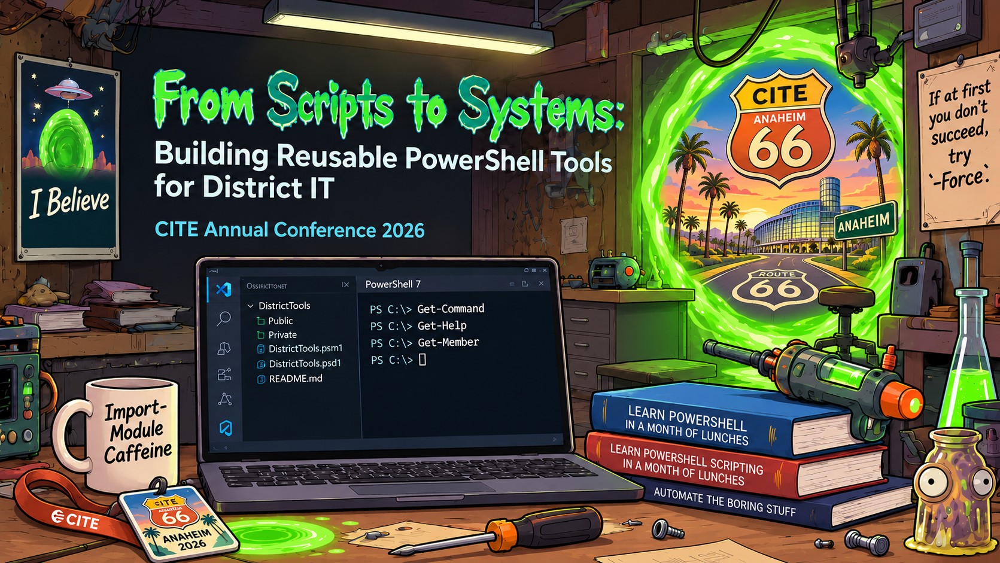
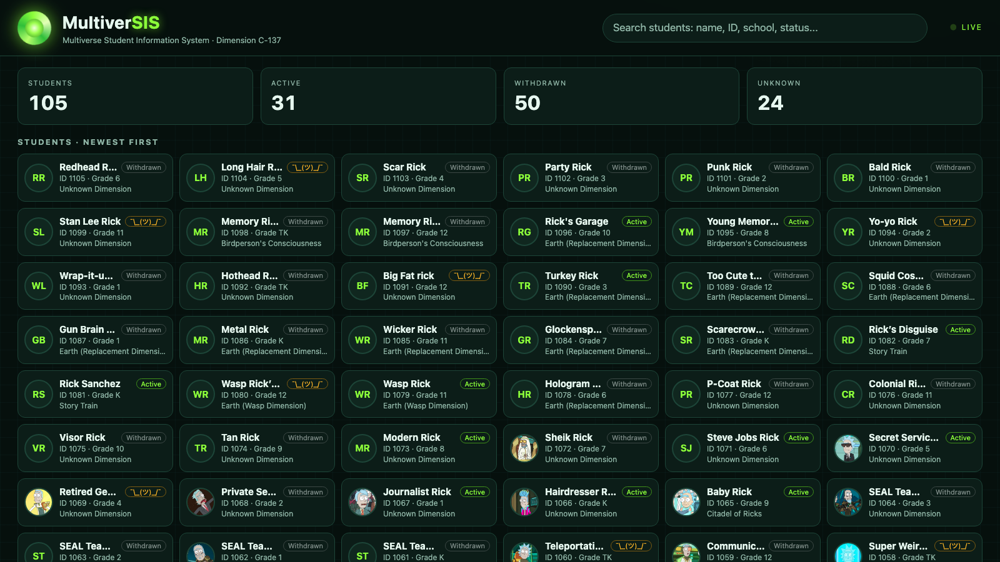

# From Scripts to Systems

**Building reusable PowerShell tools for district IT** · CITE Annual Conference 2026



Start with three commands (`Get-Command`, `Get-Help`, `Get-Member`), grow a one-liner into a real tool, then snap tools together like Lego bricks across systems that were never designed to work together. Along the way: where to keep secrets, and how to teach an AI assistant to use the tools you built.

Everything runs on your laptop. The "SIS" is **MultiverSIS**, a small web API written in PowerShell, full of students borrowed from the [Rick and Morty API](https://rickandmortyapi.com). No real students were harmed.



## What's in here

| Folder | What it is |
|---|---|
| [`slides/`](slides) | The slide deck ([Slidev](https://sli.dev)). Presenter notes on every slide. |
| [`demos/`](demos) | [`demo.ps1`](demos/demo.ps1): every command from the talk, in order. Plus the script-to-function evolution. |
| [`modules/`](modules) | **RickMortyApi** (the "vendor" API), **DistrictTools** (your district's rules), **MultiverSIS** (the SIS client). |
| [`server/`](server) | The MultiverSIS server and its live dashboard. |
| [`mcp/`](mcp) | An MCP server that lets AI assistants use the MultiverSIS commands. |
| [`setup/`](setup) | One script to install prerequisites, one to check your lab. |
| [`from-scripts-to-systems.pdf`](from-scripts-to-systems.pdf) | The slides as a PDF, if you just want to read them. |
| [`docs/`](docs) | The [find-your-small-problem worksheet](docs/worksheet.md) and the [presenter runbook](docs/presenter-runbook.md). |

## Follow along (Mac or Windows)

You need **PowerShell 7.4 or newer**.

- **Mac:** `brew install powershell`
- **Windows:** `winget install --id Microsoft.PowerShell --source winget`

Then open `pwsh` and run:

```powershell
git clone https://github.com/jgmachine/CITE-2026-PowerShell.git
cd CITE-2026-PowerShell
./setup/Install-Prereqs.ps1
./setup/Test-Lab.ps1
```

> Downloaded the ZIP instead of cloning, on Windows? Unblock the scripts first:
> `Get-ChildItem -Recurse | Unblock-File`

Start MultiverSIS in a **second** terminal and leave it running. It prints your API key.

```powershell
./server/Start-MultiverSIS.ps1
```

Open the dashboard at <http://localhost:8080>. Then open [`demos/demo.ps1`](demos/demo.ps1) in VS Code. It holds every command from the talk, in order. Put the cursor on a line and press **F8** to run it, or copy and paste lines into your terminal.

## The demos

[`demos/demo.ps1`](demos/demo.ps1) has one section per act:

| Act | What you'll see |
|---|---|
| I | `Get-Command`, `Get-Help`, and `Get-Member` on `Get-Process`, then on a web API you've never seen. Discover pagination. |
| II | The finished `Get-RMCharacter` function: every page, `[ValidateSet()]`, `-Verbose`, and real help. The five versions it grew through are in [`02-evolution/`](demos/02-evolution). For a simple way to log a script, see [`logging-example.ps1`](demos/logging-example.ps1). |
| III | The Ricks become students: vendor records in, SIS records out, `-WhatIf` first. Click any student on the dashboard for their full profile. |
| IV | The API key comes from a vault with `Get-Secret`, not from the script. |
| V | What an AI reads to learn your module, the prompt you'd give it, and the script it writes back. |

The whole talk in one pipeline:

```powershell
Get-RMCharacter -Name rick |
    ConvertTo-SISStudent |
    New-SISStudent -WhatIf
```

No Wi-Fi? Set `$env:RMAPI_OFFLINE = 1` before importing the modules. RickMortyApi also switches to its built-in snapshot by itself when it can't reach the API.

## Teach AI your tools

You don't need anything new to start. Four steps make a module easy for an AI coding agent (Copilot, Claude Code, Codex) to use correctly:

1. **Make the module findable.** Installed on your machine is enough for an agent that can run commands; it doesn't have to live in your project. Opening the module's folder in VS Code also works, and lets the agent read the source.
2. **Add an instructions file.** Copilot reads [`.github/copilot-instructions.md`](.github/copilot-instructions.md); Claude Code reads `CLAUDE.md`; Codex reads `AGENTS.md`. Tell it to run `Get-Command` and `Get-Help` before writing code, to use your functions, and to show `-WhatIf` first.
3. **Write comment-based help** with `.SYNOPSIS`, `.PARAMETER`, and `.EXAMPLE`. The agent reads it the same way you do.
4. **Make it check its work** with `Get-Command <name> -Syntax` and `Get-Help <name> -Examples`, so it uses real parameter names.

The Act V section of [`demos/demo.ps1`](demos/demo.ps1) shows what the agent runs to learn MultiverSIS, and a prompt to try. Module on a public GitHub repo? [GitMCP](https://gitmcp.io) lets an agent search it (it reads your code; it doesn't run it).

## Going further: let an AI run your tools (MCP)

[`mcp/Start-MultiverSISMcp.ps1`](mcp/Start-MultiverSISMcp.ps1) turns MultiverSIS commands into tools that GitHub Copilot, Claude, and other MCP clients can call. It's plain PowerShell: every tool description comes from `Get-Command` and `Get-Help`, so your comment-based help and `[ValidateSet()]` values are what the AI reads.

It's careful on purpose:

- Only allowlisted commands are exposed, and the default list is read-only.
- `Get-*` commands are marked read-only. Commands marked `ConfirmImpact = 'High'` are refused.
- Only parameters the server advertised are passed through.
- Every tool call is logged to stderr.

See what the AI sees:

```powershell
./mcp/Start-MultiverSISMcp.ps1 -ListTools | Select-Object name, description
```

**VS Code (GitHub Copilot):** open this folder. [`.vscode/mcp.json`](.vscode/mcp.json) is already set up. Start the `multiversis` server, paste the API key when VS Code asks (it stores it securely), and use Copilot Chat in Agent mode.

**Claude Desktop or other MCP clients:**

```json
{
  "mcpServers": {
    "multiversis": {
      "command": "pwsh",
      "args": ["-NoProfile", "-NonInteractive", "-File", "/full/path/to/CITE-2026-PowerShell/mcp/Start-MultiverSISMcp.ps1"],
      "env": { "MULTIVERSIS_API_KEY": "paste-the-lab-key-here" }
    }
  }
}
```

That puts a key in a config file, which is fine for a fake SIS on your laptop. For anything real, see Act IV.

Prefer something off the shelf? Look at [PoshMCP](https://github.com/cezarypiatek/PoshMCP), [pwsh.mcp](https://github.com/warm-snow-13/pwsh-mcp), and [PowerShell.MCP](https://github.com/yotsuda/PowerShell.MCP).

## Run the slides

```bash
cd slides
npm install
npm run dev
```

The deck opens at <http://localhost:3030>. Presenter view (with notes and a timer) is at <http://localhost:3030/presenter>. Arrow keys, the space bar, and most clickers advance it.

Just want to read the slides? There's a PDF copy: [`from-scripts-to-systems.pdf`](from-scripts-to-systems.pdf). To export a fresh one, run `npm install -D playwright-chromium`, then `npm run export`.

To publish the slides to GitHub Pages, make the repo public, then set **Settings > Pages > Source** to **GitHub Actions**. [The workflow](.github/workflows/deploy-slides.yml) builds and deploys on every push to `slides/`. (It skips itself while the repo is private.)

## Keep learning

**Books**

- [*Learn PowerShell in a Month of Lunches*](https://www.manning.com/books/learn-powershell-in-a-month-of-lunches), 4th ed. (Plunk, Petty, Leonhardt, Hicks; Manning, 2022). Start here.
- [*Learn PowerShell Scripting in a Month of Lunches*](https://www.manning.com/books/learn-powershell-scripting-in-a-month-of-lunches-second-edition), 2nd ed. (Petty, Jones, Hicks; Manning, 2024). This talk, as a book.
- [*Shell of an Idea: The Untold History of PowerShell*](https://leanpub.com/shell-of-an-idea) (Don Jones, 2020). Not a how-to: the story of how PowerShell got made.
- *The PowerShell Scripting and Toolmaking Book* (Don Jones and Jeff Hicks; Leanpub).
- *PowerShell for Sysadmins* (Adam Bertram; No Starch Press).

**Free**

- [Microsoft Learn: PowerShell](https://learn.microsoft.com/powershell/)
- [Introduction to PowerShell](https://learn.microsoft.com/training/modules/introduction-to-powershell/), a free Microsoft Learn module
- [PowerShell 101, chapter 10: Script modules](https://learn.microsoft.com/powershell/scripting/learn/ps101/10-script-modules) (Mike F. Robbins), a free book on Microsoft Learn. How to turn your functions into a module
- `Get-Help about_*`, already on your computer (run `Update-Help` first)
- [Pester](https://pester.dev): PowerShell's testing framework. Small tests that prove your functions still work, which is especially handy when AI is writing some of the code
- [PowerShell.org](https://powershell.org) forums and Discord, and [r/PowerShell](https://www.reddit.com/r/PowerShell/)

## Real modules from a real district

The same ideas, used for real work. Jesse wrote these modules at his previous district, Shasta Union High School District, and they're published under the district. Each one wraps one system:

- [SPSAeries](https://www.powershellgallery.com/packages/SPSAeries): the Aeries SIS API.
- [SPSAeriesAssetSync](https://www.powershellgallery.com/packages/SPSAeriesAssetSync): syncs Chromebooks between the Google Admin Console and Aeries. Two systems and one module between them, like the pipeline in this talk.
- [SPSFreshService](https://www.powershellgallery.com/packages/SPSFreshService): FreshService.
- [SPSMonday](https://www.powershellgallery.com/packages/SPSMonday): Monday.com boards.
- [SPSImmyBot](https://www.powershellgallery.com/packages/SPSImmyBot): ImmyBot.

All of them, with source: [PowerShell Gallery profile](https://www.powershellgallery.com/profiles/jgeron-suhsd) and [github.com/suhsdit](https://github.com/suhsdit).

## License

[MIT](LICENSE). Use the code however you like. The character data and images belong to the Rick and Morty API and the show's owners, and the book covers belong to their publishers; see the credits below.

## Credits

- Character data from the [Rick and Morty API](https://rickandmortyapi.com) by Axel Fuhrmann.
- MultiverSIS runs on [Pode](https://github.com/Badgerati/Pode). The slides are built with [Slidev](https://sli.dev).
- Book covers © Manning Publications, shown to identify the recommended books. Icons from [Phosphor](https://phosphoricons.com) (MIT).
- Fonts: Creepster, Nunito, JetBrains Mono (SIL Open Font License), and Permanent Marker (Apache 2.0).
- The whole talk was built with AI assistance: the slides, the code, and the title art. A human put a lot of hours into directing, rewriting, and testing all of it, which is the talk's own advice: read it, direct it, build it.
- Yes, there's a Python book in the stack on the title art. If you spotted it, you get a gold star. ⭐

*Rick and Morty* is a trademark of its owners. This project isn't affiliated with or endorsed by Adult Swim or the show's creators.
